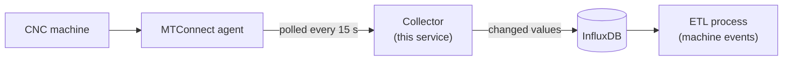
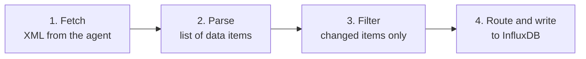

# How the collector works

This page explains what the collector does and why, starting from the big picture and moving step by step towards the code. Setup and configuration are covered in the [README](../README.md).

## The big picture



The collector never talks to the machine itself. It asks the machine's MTConnect agent for the latest values, keeps the ones that have changed and stores them in InfluxDB.

The collector does not interpret the data. It does not decide, for example, whether the machine is producing or standing still. That is the job of the next step, the ETL process.

## Concepts to know first

### MTConnect agent

MTConnect is an open standard for reading data from machine tools. The agent is a small web server that runs next to the machine and offers the machine's data over HTTP as XML.

The collector uses one endpoint: `current`, which returns the latest value of every data item. Another endpoint, `probe`, lists which data items the machine has.

### Data item

A data item is one thing the machine reports, such as spindle speed, load or the name of the running program. In the XML it looks like this:

```xml
<Load dataItemId="cl" timestamp="2025-10-29T11:55:56.294176Z" name="Cload" sequence="87656">0</Load>
```

- `Load` is the **element**: the standard MTConnect type of the item
- `Cload` is the **name**: what the machine builder called this particular item
- `0` is the **value**
- `timestamp` tells when the value last changed on the machine
- `sequence` is explained in the next section

The items are grouped into three sections: **Samples** (measured numbers), **Events** (states and texts, such as the program name) and **Condition** (health: normal, warning or fault).

### Sequence number

The agent keeps a running counter. Every time any value changes, the counter goes up and the new value gets the next number.

So if a data item has the same sequence number as in the previous poll, its value has not changed. This is how the collector recognises new data.

The numbering belongs to one run of the agent. When the agent restarts, for example after the machine has been switched off, it gets a new instance id (`instanceId` in the XML header) and the counter starts again from the beginning. The collector notices the new instance and treats every value as new.

### InfluxDB: measurement, tags and fields

InfluxDB is a database for time series, meaning values that are tied to a moment in time. Each row has four parts:

| Part        | Meaning                  | In this collector                          |
| ----------- | ------------------------ | ------------------------------------------ |
| Measurement | Like a table             | `mtc_metrics` or `mtc_status`              |
| Tags        | Labels for finding rows  | `device`, `component`, `element`, `name`   |
| Field       | The value itself         | `value` (a number) or `state` (a text)     |
| Timestamp   | When the value is valid  | The data item's own timestamp              |

A row is identified by its measurement, tags and timestamp. Writing a row with the same identity again replaces the old row instead of adding a new one. Because of this, sending the same data twice does not create duplicates.

## One poll, step by step

The collector repeats the same four steps on every poll.



1. **Fetch.** One HTTP request to the agent's `current` endpoint.
2. **Parse.** The XML is turned into a flat list, one entry per data item. The bundled sample gives 86 items.
3. **Filter.** Items whose sequence number has not grown since the previous poll are dropped.
4. **Route and write.** Each remaining item is written to `mtc_metrics` or `mtc_status`, or skipped. If InfluxDB does not answer, the rows wait in memory (see [Database down](#the-service-over-time)).

### How an item is routed

The routing uses two lists in the configuration file: `numeric_elements` and `status_elements`. Items are matched by their **name**, not by their element. Examples from the bundled sample:

| Data item                                   | Why                                          | Row in InfluxDB                   |
| ------------------------------------------- | -------------------------------------------- | --------------------------------- |
| `Cload` = `0`                               | Listed as numeric, and the value is a number | `mtc_metrics`, `value` = `0.0`    |
| `execution` = `STOPPED`                     | The value is not a number                    | `mtc_status`, `state` = `STOPPED` |
| `servo_cond` (Condition `Normal`, no value) | No value, so the element is used             | `mtc_status`, `state` = `normal`  |

A number that is not listed is skipped. In the sample, 20 items go to `mtc_metrics`, 51 to `mtc_status` and 15 are skipped.

When the agent has no value for an item, it reports `UNAVAILABLE`. That is not a number, so the item goes to `mtc_status` even if it is listed as numeric.

The row keeps the timestamp the agent gave, so it tells when the value changed on the machine, not when the collector happened to ask. Put together, the `Cload` row looks like this:

```text
mtc_metrics  device=MAZAK-SAMPLE-0001 component=c element=load name=cload  value=0.0  2025-10-29T11:55:56.294176Z
```

## The service over time

**Start.** The collector reads its settings and prints one start-up line. The line shows whether a token is set (`token_set=yes`) but never the token itself.

**Where the rows go.** If InfluxDB is enabled and a token is set, rows are written to InfluxDB. Otherwise the collector runs as a dry run and only prints the first rows. This makes it safe to try the collector without a database.

**First poll.** After a start the filter has no memory yet, so the whole snapshot is written. Rows that already exist in InfluxDB are simply replaced. The first poll also logs every item the agent offers, which helps when setting up a new machine.

**After that.** One poll every `POLL_INTERVAL` seconds (15 s by default). With `RUN_ONCE=1` the collector polls once and exits.

**Is the agent online?** Every poll also records whether the agent answered: a row in `mtc_status` with the name `machine_status` and the field `online` (1 or 0). It is written only when the state changes, so a long outage is one row, not one row per poll. This row uses the collector's clock, because a missing agent gives no timestamp.

**Database down.** If InfluxDB cannot be reached, the rows wait in the collector's memory and are written as soon as it answers again, each with its original timestamp. At most `buffer_max_rows` rows wait (50 000 by default, about 35 MB). When the limit is reached, older values of the same item give way first, so the latest value of every item is always kept. A restart of the collector empties the waiting rows; the whole snapshot of the first poll then brings the latest values back.

**Errors.** If something fails, the error is logged and the next poll tries again. The service does not stop.

## From concepts to code

Each step has its own module under `mtc_processor/`. Reading them in this order follows the data:

| Step                | File                                     | Main name                    |
| ------------------- | ---------------------------------------- | ---------------------------- |
| Start and poll loop | `runner.py`                              | `main()`, `run_once()`       |
| Settings            | `config.py`                              | `AppConfig`                  |
| 1. Fetch            | `ingest.py`                              | `IngestClient`               |
| 2. Parse            | `transform.py`                           | `parse_mtconnect()`          |
| 3. Filter           | `dedupe.py`                              | `ItemSequenceDeduper`        |
| 4. Route            | `processors/metrics.py`                  | `MetricsProcessor`           |
| 4. Wait if needed   | `storage/buffered.py`                    | `BufferedStore`              |
| 4. Write            | `storage/influx.py`, `storage/dryrun.py` | `InfluxStore`, `DryRunStore` |

### Two interfaces

Step 4 is split in two on purpose, and both halves have an interface in `processors/base.py`:

- **`BaseProcessor`** decides *what* to write. It receives the filtered items of each poll.
- **`BaseStore`** decides *where* to write. Its main method is `write_point()`; a store that can send many rows in one request also overrides `write_points()`, as `InfluxStore` does.

Because the halves are separate, a processor does not know whether it writes to InfluxDB or to the screen. The dry run is simply another store. So is `BufferedStore`: it wraps the real store and keeps the rows while the database cannot be reached.

This is also how the collector is extended without touching the rest:

- **New processing:** a `BaseProcessor` subclass, added to `build_processors()` in `runner.py`
- **New storage target:** a `BaseStore` implementation, chosen in `build_store()` in `runner.py`. `build_store()` wraps every store in `BufferedStore`, so the new store only has to raise an error when its target cannot be reached, and `RejectedError` when the rows will never be accepted.

## Try it yourself

The fastest way to see all of this happen is the local test environment, which needs no machine or real database:

```bash
dev/test.sh smoke
```

It polls a simulated agent for a few seconds, stores the rows in a throwaway InfluxDB and prints the row counts. The agent serves the bundled sample and changes a few values on every poll, so the filter can be seen at work: the later polls store only the changed values. More options are in the README section [Development on Linux OS](../README.md#development-on-linux-os).
